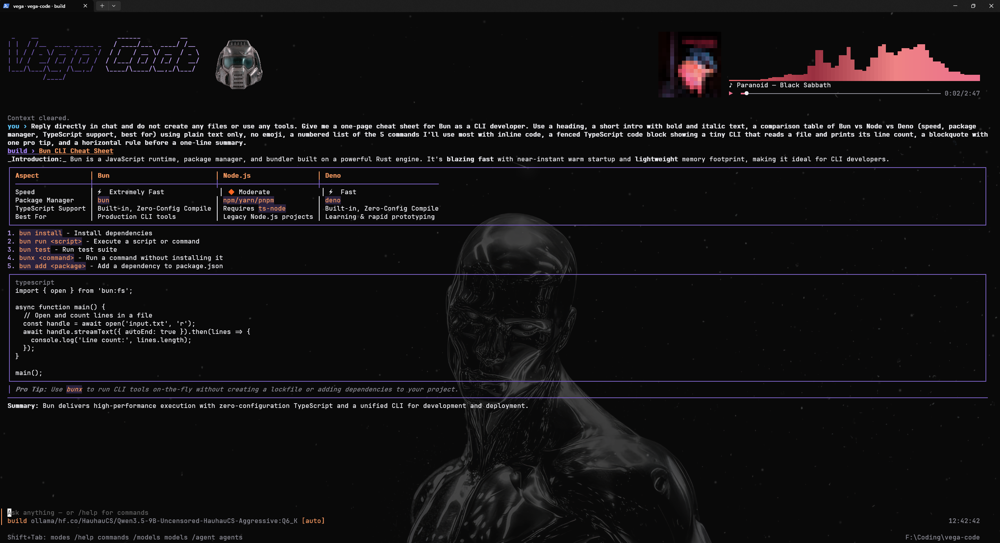

# vega-code

An agentic coding CLI built on Bun + the Vercel AI SDK. Built around the tool definitions, wildcard permission ruleset,
context compaction, and subagent architecture that make an agentic CLI actually usable.

**Puts the vibe in vibe coding.**


## Screenshot



## What's implemented

- **Tools**: `read`, `write`, `edit`, `patch` (multi-file add/update/delete/move), `bash` (with background execution),
  `glob`, `grep`, `webfetch`, `websearch`, `todo`, `task` (subagent spawn), `question`, `skill`, and LSP-backed
  `hover` / `definition`. The `edit` and `patch` matchers are CRLF- and typographic-aware.
- **Permissions**: wildcard `allow`/`deny`/`ask` ruleset. In the TUI, an approval surfaces as buttons on the
  triggering tool-call box — Approve / Always / Reject — with the model's own one-line `reason` for the action
  shown alongside it. Only one approval is active at a time; if several tool calls need permission at once, the
  rest queue behind it instead of stacking prompts.
- **Providers**: Anthropic, OpenAI, DeepSeek, Groq, and local Ollama, switchable live via `/provider` / `/models` — model
  lists are fetched from each provider's own API (`ollama list` for Ollama), never a hardcoded table. Groq and
  Ollama have no fixed default model: first launch on either fetches the live list and has you pick one.
- **TUI**: a full-screen OpenTUI interface — assistant replies render as markdown (headings, lists, code blocks,
  tables, inline emphasis) instead of raw syntax; `edit` tool calls show a red/green line diff instead of a raw
  oldString/newString dump; typing `/` opens a filtered slash-command suggestion menu; `/thinking` (or double-tap
  Tab) toggles the model's reasoning output; the status line shows a live context counter
  (`↑prompt ↓completion  ctx used/limit (%)`); Up/Down in the prompt cycles through previously submitted messages.
- **Context management**: `AGENTS.md` project instructions, token-based overflow detection, LLM-summarized
  compaction that keeps the last 10 messages verbatim and folds the rest into a summary. For Ollama the context
  limit is read live from `/api/show` (the model's max, or an explicit Modelfile `num_ctx`) instead of a fixed default.
- **Skills**: drop-in skills (`SKILL.md` or a flat `*.md`) under `.vega/skills/` or `~/.vega-code/skills/`; their
  names/descriptions are surfaced in the system prompt and loaded on demand with the `skill` tool (or listed with `/skills`).
- **Subagents**: the `task` tool spawns a nested agent loop (`general` agent: read-only) with a configurable
  `subagentDepth` limit and an optional per-call model override.
- **Session persistence**: JSON files under `.vega/sessions/`, `--continue` resumes the most recent one

## Setup

```
bun install
cp .env.example .env   # fill in ANTHROPIC_API_KEY, OPENAI_API_KEY, DEEPSEEK_API_KEY, and/or GROQ_API_KEY
```

Ollama needs no API key, just the `ollama` CLI on PATH with the daemon running.

`websearch` and `webfetch` use Python (`pip install ddgs trafilatura`). The optional header music visualizer is
Windows-only (`pip install -r visualizer/requirements.txt`; disable with `VEGA_VISUALIZER=off`).

## Usage

```
bun run src/index.ts                                # interactive REPL
bun run src/index.ts "fix the bug in src/foo.ts"    # one-shot
bun run src/index.ts --continue                     # resume the most recent session
bun run src/index.ts --provider groq                # override provider (anthropic|openai|deepseek|ollama|groq)
bun run src/index.ts --model <id>                   # override model
```

Slash commands in the REPL: `/help`, `/models`, `/provider`, `/agent`, `/plan`, `/build`, `/auto`, `/compact`,
`/clear`, `/thinking`, `/init`, `/skills`, `/change-dir` (`/cd`), `/exit`. Typing `/` in the TUI opens a filtered
suggestion menu for these.

## What's deliberately left out (vs. real opencode)

A production-grade agentic CLI would be a large team's Effect-TS codebase with SQLite-backed durable sessions,
an HTTP/SSE server plus a separate TUI client, a full LSP pipeline (diagnostics, rename, references), MCP servers,
AST-based shell-command permission scanning, a plugin system, and a dozen provider integrations. This project keeps
the *mechanisms* (permission evaluation, compaction, subagent isolation, tool truncation) but skips the
infrastructure scale-out — it's meant as a readable, hackable starting point, not a drop-in replacement.
